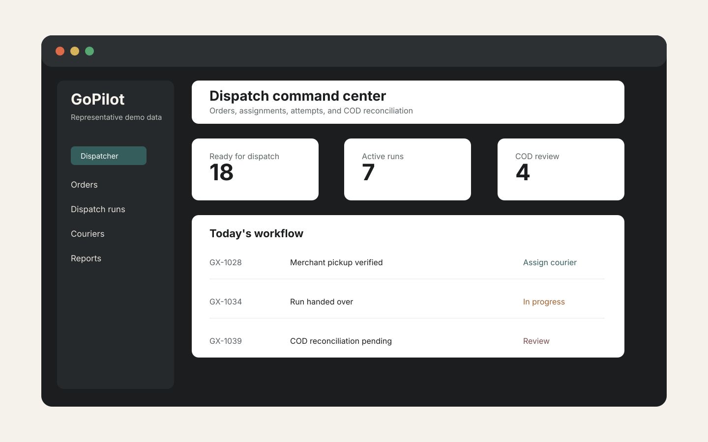

# GoPilot Express Case Study

**Multi-role delivery operations platform for dispatch, merchant, courier, and owner workflows.**

> Source code is private/client-confidential. Architecture and implementation details are shared at a safe case-study level.

GoPilot Express is a production-oriented delivery operations system designed around the real workflow pressure of merchants, dispatchers, couriers, and owners. The public case study focuses on architecture, product decisions, and delivery standards without exposing proprietary source code, credentials, customer data, or production records.

**Building a logistics, dispatch or multi-role business application?** [Request a scoped engineering proposal](https://docs.google.com/forms/d/e/1FAIpQLSeTtJoymcR3Zr4JdVvCq8lY1yuiyp6w_FI_hqiLG6IvEJgqDg/viewform) or [see the full portfolio](https://mjszeineddine.github.io/). This is an architecture case study; confidential source and real customer information are not public.

## Business Problem

Delivery teams need a reliable operating layer between merchants, dispatchers, couriers, and business owners. The platform had to support order intake, dispatch coordination, courier execution, proof handling, COD operations, reporting, and bilingual usage without relying on live tracking or fleet-management claims.

## Users And Roles

- **Owner:** reviews operational health, reports, merchants, finance state, and configuration.
- **Dispatcher:** coordinates orders, creates dispatch runs, assigns couriers, and manages exceptions.
- **Merchant:** creates and reviews shipments, pickup details, order status, and settlement context.
- **Courier:** handles runs, attempts, delivery outcomes, proof capture, and COD collection.

## Core Workflows

- Shipment/order workflow from merchant input through dispatch and completion.
- Dispatch runs, handover, attempts, postponements, failures, and returns.
- Role-based access around operational screens and protected actions.
- Public tracking by reference and PIN with restricted data exposure.
- COD collection, reconciliation, settlement context, and CSV/reporting flows.
- Arabic/English interface support, RTL layout, and responsive dashboards.

## Architecture

The documented system used a React/TypeScript/Vite frontend with a FastAPI/Python backend and relational database foundation. The production-oriented architecture included API-owned business rules, role-aware data access, deployment configuration, Docker support, CI/release verification, and documented operational runbooks.

Read more:

- [Architecture](docs/architecture.md)
- [Features](docs/features.md)
- [Engineering Decisions](docs/engineering-decisions.md)
- [Quality And Delivery](docs/quality-and-delivery.md)

## Engineering Challenges

- Keeping pricing, quote, COD, courier, and role decisions server-authoritative.
- Designing operational dashboards that work on desktop and mobile without leaking cross-tenant data.
- Supporting bilingual Arabic/English UX and RTL behavior.
- Preparing release controls that verify frontend, backend, database, deployment, and archive safety.
- Avoiding unsupported product claims such as GPS, live maps, geofencing, fleet management, fuel, or vehicle maintenance.

## Quality Controls

Local project documentation references TypeScript, linting, unit/API tests, PostgreSQL concurrency checks, browser E2E journeys, accessibility checks, performance budgets, deployment verification, archive verification, and source-policy scanning.

## Deployment Approach

The delivery approach separated local development, staging certification, production promotion, environment files, Docker/deployment configuration, cloud resources, rollback drills, and runbooks. Public details remain intentionally high level.

## Contact

Need a white-label engineer for a production rescue or scoped build? Contact [mjawadzeineddine@gmail.com](mailto:mjawadzeineddine@gmail.com).
